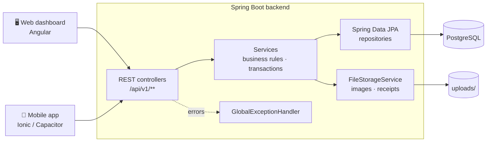
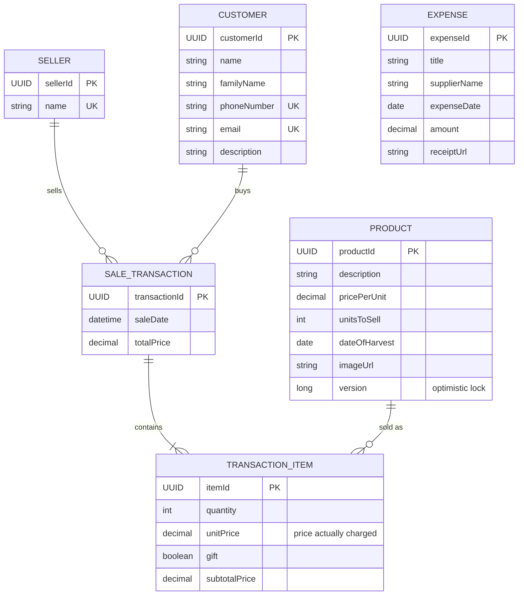

<div align="center">

# 🍯 Honey Management System

**Backend for a family beekeeping business: products & stock, sales with receipts, expenses with scanned bills, and live statistics.**

[](https://github.com/omarastoder-create/HoneyManagementSystem/actions/workflows/ci.yml)
[](https://sonarcloud.io/summary/new_code?id=omarastoder-create_HoneyManagementSystem)
[](https://sonarcloud.io/summary/new_code?id=omarastoder-create_HoneyManagementSystem)
<br/>


[Features](#-features) · [Architecture](#-architecture) · [API](#-api) · [Getting started](#-getting-started) · [Quality](#-quality--ci)

</div>

---

## ✨ Features

| | |
|---|---|
| 🫙 **Products & stock** | Honey varieties with price, harvest date and photo. Stock is reduced on every sale, with optimistic locking so two parallel sales can never oversell a jar. |
| 🛒 **Sales** | Multi-item sales with special prices and gifts. Unit price and gift flag are stored per line, so receipts stay correct even when prices change later. |
| 🧾 **Expenses & receipts** | Track costs (sugar, jars, equipment) and attach the bill as PDF or photo. Files are validated by content, not just by name. |
| 👥 **Customers & sellers** | Contact data with unique phone/email, editable via `PUT`. Sellers are the family members who sell. |
| 📊 **Statistics** | Revenue, expenses, net profit, monthly revenue, top customer and top seller per month and year. |
| 🛡️ **Consistent errors** | Every error, from validation to 500, returns the same JSON shape with per-field messages. |

### Clients

| Client | Stack | Repository |
|---|---|---|
| 🖥️ Web dashboard | Angular 22 | [honey-management-frontend](https://github.com/omarastoder-create/honey-management-frontend) |
| 📱 Mobile app | Ionic 9 · Capacitor 8 | [honey-management-mobile](https://github.com/omarastoder-create/honey-management-mobile) |

---

## 🏗️ Architecture



**Design principles**

- **Layered:** controllers only do HTTP, services own the business rules and transactions, repositories only do persistence.
- **DTO boundary:** requests and responses are Java records; JPA entities never leave the service layer.
- **Constructor injection everywhere** via Lombok's `@RequiredArgsConstructor`, with no field injection.
- **Files follow the transaction:** an uploaded file is deleted if the database transaction rolls back, and a replaced file only after a successful commit.
- **Secure uploads:** allow-list of types, magic-byte check, and server-generated filenames (no path traversal, no HTML/SVG served from the API origin).

### Domain model



---

## 🔌 API

Base path: `/api/v1`. Uploaded files are served at `/images/**` and `/receipts/**`.

| Resource | Endpoints |
|---|---|
| **Products** | `GET /products` · `POST /products` *(multipart: `product` JSON + optional `image`)* |
| **Sales** | `GET /transactions` · `GET /transactions/{id}` · `POST /transactions` |
| **Expenses** | `GET /expenses` · `GET /expenses/{id}` · `POST /expenses` · `PATCH /expenses/{id}` · `DELETE /expenses/{id}` |
| **Receipts** | `PUT /expenses/{id}/receipt` *(multipart `file`: PDF, PNG, JPEG, WebP)* · `DELETE /expenses/{id}/receipt` |
| **Customers** | `GET /customers` · `POST /customers` · `PUT /customers/{id}` |
| **Sellers** | `GET /sellers` · `POST /sellers` |
| **Statistics** | `GET /statistics` |

<details>
<summary><b>Example: create a sale with a special price and a gift</b></summary>

```http
POST /api/v1/transactions
Content-Type: application/json

{
  "sellerId": "…",
  "customerId": "…",
  "items": [
    { "productId": "…", "quantity": 2, "customPricePerUnit": 8.50, "isGift": false },
    { "productId": "…", "quantity": 1, "customPricePerUnit": null, "isGift": true }
  ]
}
```
</details>

<details>
<summary><b>Error format</b></summary>

Every error uses the same shape; validation errors add `fieldErrors`.

```json
{
  "timestamp": "2026-10-22T10:15:30",
  "status": 400,
  "error": "Bad Request",
  "message": "Validation failed",
  "fieldErrors": { "phoneNumber": "Invalid phone number format" }
}
```

| Status | When |
|---|---|
| `400` | Validation, malformed JSON, invalid UUID, business rule (e.g. not enough stock) |
| `404` | Entity not found |
| `409` | Duplicate value, or the same product changed concurrently |
| `413` | Upload larger than 8 MB |
| `500` | Unexpected error (logged; no internals in the response) |
</details>

---

## 🚀 Getting started

**Requirements:** JDK 21 and Docker (for PostgreSQL).

```bash
./mvnw spring-boot:run
```

Spring Boot starts the PostgreSQL container from [`compose.yaml`](compose.yaml) automatically. The API runs on `http://localhost:8080`.

> **Without Docker:** use an in-memory H2 database instead:
> `./mvnw spring-boot:run -Dspring-boot.run.arguments=--spring.docker.compose.enabled=false`
>
> **Development mode:** the schema is recreated on every start (`ddl-auto=create-drop`), so data does not survive a restart.

### Configuration

| Property | Default | Purpose |
|---|---|---|
| `app.cors.allowed-origins` | web (`:4200`), mobile (`:8100`, Capacitor) | Which frontends may call the API |
| `app.storage.root` | `uploads` | Folder for product images and receipts |
| `spring.servlet.multipart.max-file-size` | `8MB` | Maximum upload size |

---

## ✅ Quality & CI

```bash
./mvnw verify    # build, 81 tests, JaCoCo coverage report
```

- **Tests:** JUnit 5, Mockito and AssertJ for services; `@WebMvcTest` for HTTP endpoints, CORS and file serving; a `@SpringBootTest` proving that an outdated (concurrent) stock update is rejected by the database.
- **CI:** every push and pull request to `main` runs the build and tests on GitHub Actions, then a SonarCloud analysis.
- **Quality gate:** a pull request only passes with **≥ 80 % coverage on new code**, no new bugs or vulnerabilities, at most 3 % duplicated lines, and all security hotspots reviewed.

---

## 🗺️ Roadmap

- [ ] Edit products and restock after a new harvest
- [ ] Expense categories with a cost breakdown
- [ ] Choose the date of a sale (e.g. enter market-day sales afterwards)
- [ ] Lot number and best-before date for honey labels
- [ ] Yearly export of sales, expenses and receipts for taxes
- [ ] Login for family members
- [ ] Database migrations with Flyway
